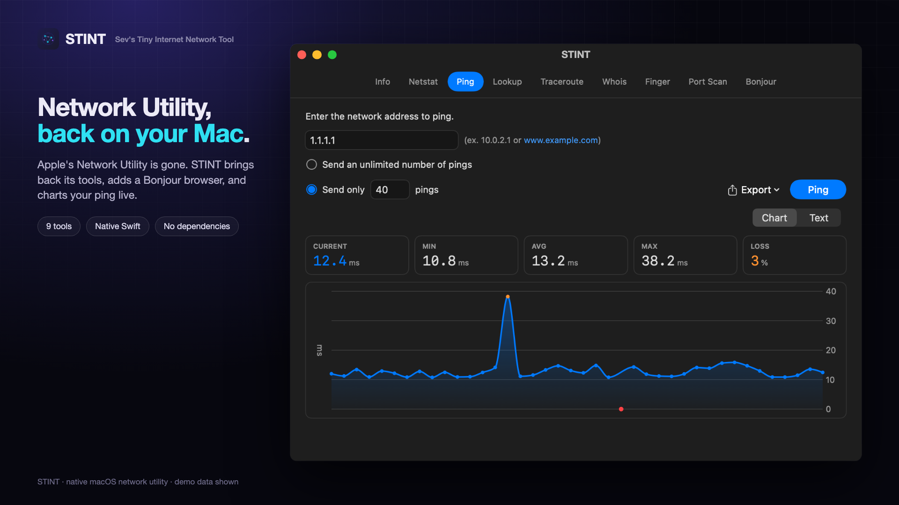
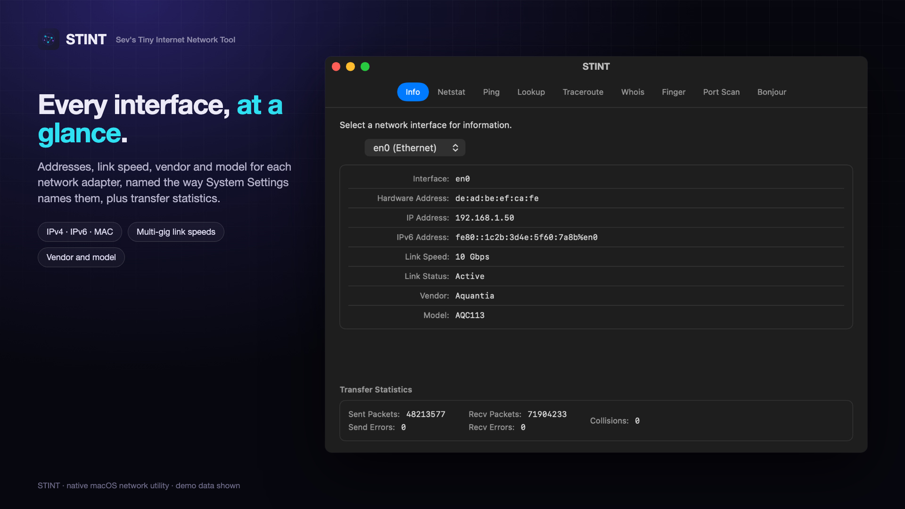
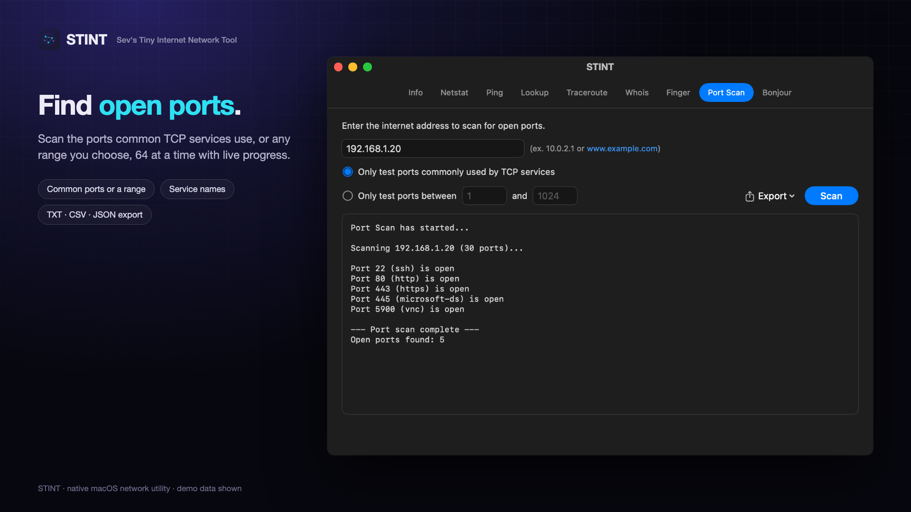
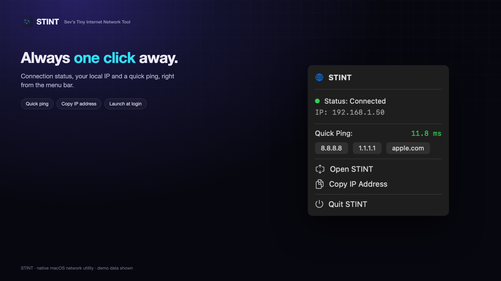
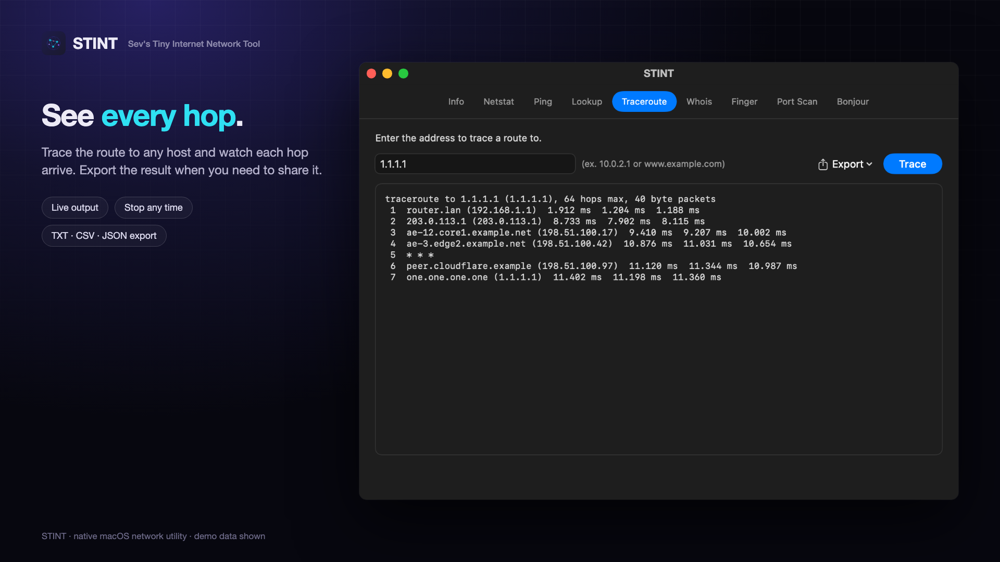
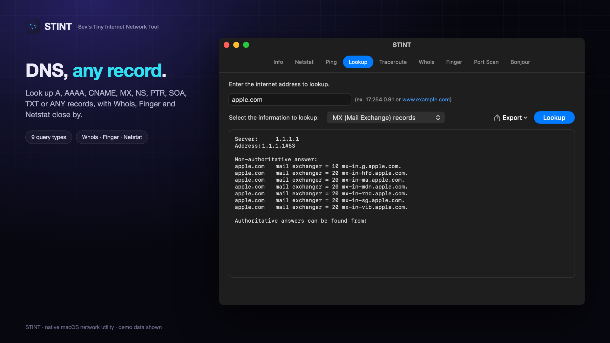
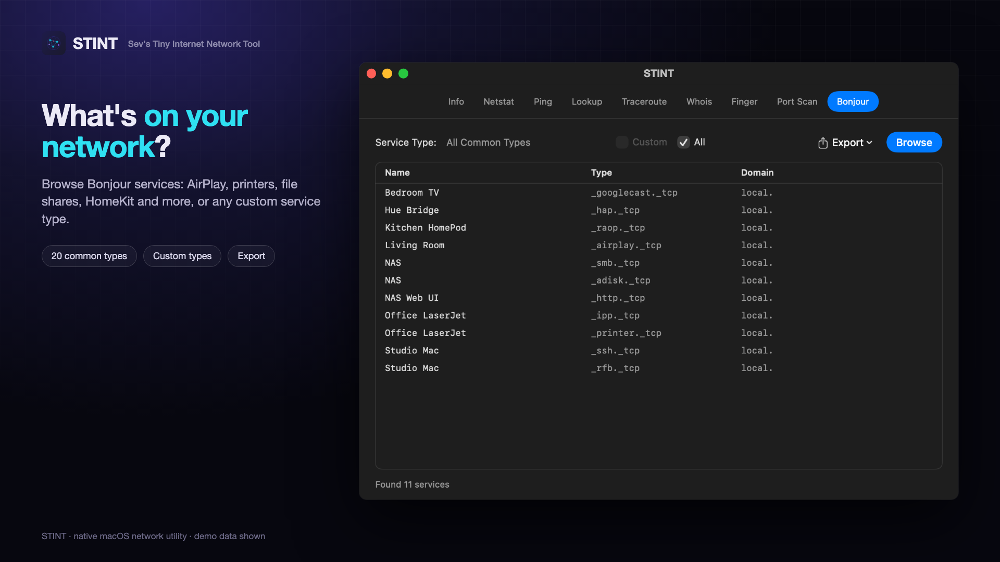

# STINT — Sev's Tiny Internet Network Tool
**by Sevag Bardakjian**

A modern macOS network utility inspired by Apple's classic Network Utility, which was deprecated after macOS Monterey. Built with SwiftUI for both Intel and Apple Silicon Macs.

Free and open source under the [GNU GPL v3](LICENSE). No accounts, analytics, telemetry, or crash reporting. See [Privacy & Security](#privacy--security) for everything STINT contacts, what it stores, and what it can do on your network.

If STINT is useful to you, you can [buy me a coffee](https://buymeacoffee.com/sevoog).

## Screenshots






<details>
<summary>More screenshots</summary>





</details>

*Screenshots use placeholder demo data; no real network details are shown.*

## Install

1. Download the latest **STINT-x.y.z.zip** from [Releases](https://github.com/Sevoog/STINT/releases/latest).
2. Unzip it and drag **STINT** into your **Applications** folder.
3. Open STINT. Because STINT isn't notarized by Apple, the first time you open it macOS says Apple could not verify that it is free of malware. Click **Done**.
4. Open **System Settings → Privacy & Security** and scroll down to **Security**. Next to the message that STINT was blocked, click **Open Anyway**, and enter your password if asked.
5. Click **Open Anyway** in the confirmation that appears. From then on, STINT opens normally.

You'll repeat steps 3–5 each time you install a new version. On macOS 13 and 14 you can instead Control-click STINT in Applications, choose **Open**, then click **Open**.

To check your download, compare its checksum with the one listed on the release page:

```bash
shasum -a 256 ~/Downloads/STINT-*.zip
```

## Features

- **Info** - View network interface information (IP address, MAC address, link status, transfer statistics)
- **Netstat** - Display routing tables, network statistics, multicast info, and socket states
- **Ping** - Ping network hosts with configurable count or unlimited mode, with a live latency chart (Swift Charts) and Chart/Text toggle
- **Lookup** - DNS lookups with support for various record types (A, AAAA, MX, NS, TXT, etc.)
- **Traceroute** - Trace the route to a network host
- **Whois** - Look up domain registration information
- **Finger** - Query finger protocol servers (legacy)
- **Port Scan** - Scan hosts for open TCP ports
- **Bonjour** - Browse for mDNS/Bonjour services on your local network

### Additional Features

- **Export Results** - Export any results to TXT, CSV, or JSON format
- **Menu Bar Widget** - Quick access to network status, IP address, and ping tests from the menu bar
- **Settings** - Configurable preferences for default values and behavior
- **macOS 26 Liquid Glass** - Automatically adopts the new Liquid Glass design when running on macOS Tahoe

## Requirements

- macOS 13.0 (Ventura) or later
- Universal binary (Apple Silicon + Intel)
- To build: Xcode 15.0 or later (Xcode 26 for Liquid Glass support)

## Building

### Option 1: Using Xcode

1. Open `STINT.xcodeproj` in Xcode
2. Select your development team in Signing & Capabilities (or disable signing for local use)
3. Build and run (Cmd+R); run the tests (Cmd+U, 17 tests in `STINTTests`)

### Option 2: Command Line

```bash
# Run the tests
xcodebuild -project STINT.xcodeproj -scheme STINT test


# Build for both Intel and Apple Silicon (Universal Binary)
xcodebuild -project STINT.xcodeproj \
  -scheme STINT \
  -configuration Release \
  -arch x86_64 -arch arm64 \
  ONLY_ACTIVE_ARCH=NO \
  CODE_SIGN_IDENTITY="-" \
  build

# The app will be in build/Release/STINT.app
```

## Menu Bar Widget

STINT includes a menu bar widget that provides:
- Network connection status indicator
- Current local IP address display
- Quick ping buttons (8.8.8.8, 1.1.1.1, apple.com)
- Copy IP address to clipboard
- Quick access to open the main window

Toggle the menu bar icon visibility via View > Show Menu Bar Icon (Cmd+Shift+M).

## Export Functionality

Results from every tool can be exported:
- Click the Export button next to the action button
- Choose format: Plain Text, CSV, or JSON
- Save to a custom location or quick-export to Downloads

## macOS 26 Liquid Glass

When compiled with Xcode 26 and running on macOS Tahoe (26), STINT's control layer adopts the new Liquid Glass design language: the tool action buttons use the system `.glass` button style, and the window and menu-bar chrome inherit the glass material from the macOS 26 SDK. The selected tab is a refined accent-colored capsule. Output/results panels intentionally stay solid for readability, following Apple's Human Interface Guidelines (glass is for the control and navigation layer, not content-heavy areas).

The Liquid Glass styling is gated behind an availability check, so on macOS 13–15 the app keeps its previous appearance and continues to build against the macOS 13 deployment target.

## Privacy & Security

STINT has no accounts, analytics, telemetry, ads, or crash reporting, and contains no third-party code. It never sends anything to me. This section lists everything STINT does on your network and on your Mac.

### Contacted automatically

Nothing. STINT makes no network requests on its own. The menu bar's connection status comes from macOS's network path monitor, which sends no traffic.

### Contacted only when you use a tool

- **Ping, Traceroute, Port Scan:** the host you enter (for Traceroute, the routers along the way reply too). Port Scan opens TCP connections to the ports you choose and closes them straight away.
- **Lookup:** your Mac's configured DNS servers, asked about the name you enter.
- **Whois:** the IANA whois server, then the whois servers it refers to for the name or address you enter.
- **Finger:** the host in the address you enter.
- **Bonjour:** sends browse queries and listens for services announced on your local network (mDNS).
- **Menu bar quick ping:** 8.8.8.8 (Google), 1.1.1.1 (Cloudflare) or apple.com, only when you click its button.
- **Info and Netstat:** nothing; they read your Mac's own network state.

### System tools STINT runs

`/sbin/ping`, `/usr/sbin/traceroute`, `/usr/sbin/netstat`, `/usr/bin/nslookup`, `/usr/bin/whois`, `/usr/bin/finger` and `/sbin/ifconfig`. What you type is passed to them as an argument, never through a shell. A running tool stops when you switch tools, close the window, or quit STINT.

### Permissions

- **First open** (not notarized): approve STINT once in System Settings → Privacy & Security; see [Install](#install).
- **Local Network** (macOS 15+). macOS asks the first time STINT, or a tool it launches such as `ping`, contacts a device on your local network. If you decline, Bonjour and anything aimed at your local network won't reach it, and Bonjour and Port Scan tell you so. You can change it later in System Settings → Privacy & Security → Local Network.
- **Login Items**: only if you turn on Launch at Login, which registers STINT as a login item.
- STINT never asks for Location Services, Notifications, the Keychain, or Full Disk Access.

### Stored on your Mac

- STINT's settings (default ping host and count, menu bar icon, launch at login), in its preferences file.
- Exports, only where you save them, or in your Downloads folder with Quick Export.

### Security notes

- **Not sandboxed.** The App Sandbox would block the system tools listed above, so STINT runs with the same file access as any app you launch yourself. It writes only what's listed above.
- **Not notarized.** Builds are ad-hoc signed and haven't been checked by Apple's notarization service.
- **Plaintext protocols.** DNS lookups, Whois (TCP 43), Finger (TCP 79), Bonjour, and the probes from Ping, Traceroute and Port Scan are unencrypted, so what they carry is visible on the network path.
- **Port scanning** can be unwelcome on networks you don't run. Only scan hosts you own or have permission to test.

## Architecture

- SwiftUI, no third-party dependencies; Swift Charts for the ping graph
- App Sandbox **disabled**: the tools run Apple's own command-line utilities (direct distribution only)
- Ping, Traceroute, Netstat, Lookup, Whois and Finger stream the system tool's output live (`Process`), and every run can be stopped
- Port Scan uses the Network framework (`NWConnection`) with 64 probes in flight; Bonjour uses `NWBrowser`
- Info combines `getifaddrs`, SystemConfiguration (adapter names), IOKit (vendor and model) and `ifconfig`/`netstat`
- Menu bar widget: `MenuBarExtra` with an `NWPathMonitor`
- Unit tests (XCTest) in `STINTTests`; screenshots are rendered from the app's own views by `marketing/render.sh`

## Changelog

See [CHANGELOG.md](CHANGELOG.md) for the full release history.

## Author

Created by Sevag Bardakjian

## Contributing

Bug reports and pull requests are welcome. See [CONTRIBUTING.md](CONTRIBUTING.md) for how to build, and the [Contributor License Agreement](CLA.md) you'll be asked to sign on your first pull request. Please report security issues privately; see [SECURITY.md](SECURITY.md).

## License

STINT is free software, licensed under the [GNU General Public License v3.0](LICENSE) (`GPL-3.0-only`). You can use, study, change, and share it. If you distribute a modified version, you must release its source code under the same license.

STINT comes with **absolutely no warranty**. Copyright © 2026 Sevag Bardakjian.

If you'd like to use STINT under terms other than the GPL, for example in a closed-source product, open an issue or get in touch through GitHub.
